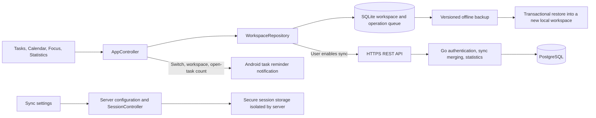

[简体中文](PROJECT_ARCHITECTURE.md) | English

# Local-first architecture with optional sync

Updated: 2026-10-31. Applies to `0.3.0-preview.3+8`. The first client supports Android. Users may deploy a server for sync; local use does not require a server.

## Components and data flow

## Local workspaces

On first launch, the client opens a SQLite workspace. Task management, scheduling, timing, and statistics work without an account. Offline changes are written to local documents and the pending-sync queue. Without a selected sync account, the queue remains on the device and is not uploaded automatically.

The UI updates tasks, projects, plans, focus state, and device settings only after successful writes. Manual task reordering writes the affected documents and queued operations in one transaction; any failure rolls back all of them. Task, project, plan, and app-allowlist editors retain input or selections, display an error, and re-enable saving after save failures. The operation-queue count is queried after document commit. Failure of that query does not undo a successful save or report creation as failed.

General task lists use `TaskItem.compareByPriority` after reads, creation, editing, and reordering: `urgent → high → medium → low → none`, then numeric `rank` ascending, then a fixed task-ID order. Filtered lists and task pickers retain that ordering. Sorting does not rewrite priorities, deadlines, or plan blocks. Today has a separate read model: tasks planned for the day use planned start time, and other tasks use `rank`, preserving manual adjustments.

Concurrent database-open requests share one opening operation. If opening fails, its cached operation is cleared. Retry on the initialization page opens the database again; failures do not permanently reuse the previous exception.

Local backups include business documents, device settings, and unsynced changes. They exclude passwords, session tokens, server configuration, and old sync cursors. Restore validates format version, fields, and entity references, then creates a new workspace in one database transaction. The original workspace remains unchanged; failed restore does not leave partially restored data.

When copying across servers, the client regenerates sync operations for the target server while retaining entity content and references. Cross-server sync must not reuse the original server's cursor or acknowledged document versions.

## Optional servers

The client supports runtime configuration and normalization of HTTPS server addresses. Credentials, device registrations, workspaces, and sync state must be isolated by server and account. Identical user IDs returned by different servers still use independent workspaces.

Connecting to a new server opens an independent cloud workspace by default. Existing local data is uploaded only after the user explicitly chooses to do so. Before switching servers, sync jobs for the old server must stop. Responses from the old server must not write into the new workspace, and its tokens must not be sent to the new server.

Expired sessions, device revocation, sign-out, or failed network requests pause sync. Local editing, focus, and export remain available. Deleting the server account and deleting the local copy are separate operations; the interface explains each effect separately.

## Sync and domain constraints

Sync uses the existing `/v1` business API, UUIDs, batched push, paginated pull, cursors, and deletion tombstones. The server checks field-level version merging, duplicate operations, active focus, and conflicts. The WebSocket API sends change hints only; clients incrementally pull data over REST to maintain consistency.

Task deadlines, plan blocks, and actual focus records are stored separately. Guard mode's device-local package names, app inventory, permissions, and allowlists are not uploaded. The server accepts focus aggregates and sanitized interruption classifications conforming to the entity contracts.

### Focus sessions and the local service

Ordinary focus can start without a task and is saved as Free focus. An unassigned terminal session can first associate an existing or new task, changing only `task_id` without recomputing timing, pauses, or statistics. Synchronized records still require the starting device; assignment cannot be cleared or changed. This requires the server in this version; older terminal-immutability rules reject it.

The client controls only active focus started on this device. New-session control markers are stored per workspace in local global settings and do not enter sync bodies or portable backups. In a synced account, matching the currently registered device to `started_device_id` also establishes control and saves a local marker. Legacy `android-local` sessions are recoverable only in the original `__local__` workspace. Backup restore and local copying do not inherit that authority.

Other devices' active focus appears in history, does not start this device's service, and cannot be paused, resumed, or ended locally. A sync workspace cannot create another focus session while any known active session exists, following the server's one-active-session-per-account constraint. Two offline devices that have not exchanged recent data may still start separately; later sync applies the server's active-session and overlap checks. External active records in a local copy remain read-only and do not block new locally started focus in that copy.

During initialization or workspace opening, the client sends the Android foreground service the local active session's ID, remaining time, pause state, local allowlist, and saved guard counts. For the same ID, service recovery retains the larger of existing and submitted counts. A different ID uses that session's submitted counts. A paused session restores a paused notification without guard monitoring. If the current workspace has no locally active session but native state is still active, the client requests stop to clear the service left behind by an ended session. Focus controls and guard-statistics refresh are serialized so concurrent creation or late statistics writes cannot reactivate ended sessions.

Native monitoring verifies its monitoring generation on the service main thread before updating counts. Stopped monitoring cannot write into subsequent sessions. The client merges native statistics only when their ID matches the current session ID. Native-service request failures do not delete persisted focus records. Reboots, reopening after force stop, notification permission, and foreground-service behavior across Android versions still require device acceptance; local Flutter tests cannot establish that notifications or guarding actually run.

### Task reminders in the notification area

Through the `pactick/task_reminders` platform channel, Android clients submit the reminder switch, current workspace ID, and number of tasks with status `open`. `AppController` updates during initialization, count/switch/workspace changes, and return to the foreground. Updates run serially; old responses cannot overwrite newer state. Initialization or workspace-switch failures cancel display of the old count snapshot. Settings offers retries for platform errors without changing local task-write results.

`TaskReminderManager` stores the switch, workspace ID, and count in Android private preferences. A separate `task_reminders` channel and fixed notification ID display one ongoing silent reminder without storing task content. Completing all tasks, turning reminders off, or system notification restrictions remove it. Workspace switching cancels the old notification before showing the new count. The count notification itself does not start alarms, background polling, or the focus foreground service. Deadline and plan-start reminders use a separate inexact-alarm path. `TaskReminderReceiver` restores the snapshot on reboot or app update. Server changes while the app is closed are not fetched independently; counts update through normal local reads and sync.

`task_reminders_enabled` defaults to on, is stored in local global settings, and is not migrated through sync or backup. On systems requiring runtime notification permission, the first open task automatically requests it once if never requested before; after denial, only the user requests again. Task reminders and focus notifications share system permission and request history. Actual availability checks both app notification permission and the reminder channel; it cannot be inferred from the switch. `MainActivity` records notification-open requests; Flutter consumes them to open Tasks while preserving unsaved-form exit confirmation. See the [getting-started guide](GETTING_STARTED.en.md) for operations and system limits. Actual notifications and reboot restoration still require device acceptance.

The reminder uses notification ID `1301` and does not automatically disappear when tapped. It does not create, read trigger times from, or update synced `reminder` entities, and does not schedule by deadlines or calendar blocks. Record real-device checks using the [ordering and task-reminder checklist](ANDROID_TASK_REMINDER_CHECKLIST.en.md).

### Local private storage and server management

`PrivateVaultController` reads and writes workspace vaults through an independent ciphertext-storage interface. After unlocking, it exposes tasks, categories, plans, and focus only to private screens. Ordinary task reads and sync documents exclude these records. `AppController` coordinates mutual exclusion between ordinary and private focus. Android native timing receives only a generic title for private focus; backgrounding and workspace changes clear decrypted memory. Workspace backup version 2 carries ciphertext but no local timing-control authority. See the [private task vault](PRIVATE_TASK_VAULT.en.md).

A separate Go manager provides a local browser interface, process operations, backups, isolated restore checks, and administrator account creation. Management authorization does not use ordinary sync tokens. Account creation remains available when public registration is disabled. See [server management](SERVER_MANAGEMENT.en.md) for the four target platforms and external-dependency limits.

Existing PostgreSQL migrations remain unchanged; future schema changes use new migrations.

## Device integrations

Language follows the system by default, with Chinese/English choices. Business UI and Android notifications share that preference; user content is not translated. Display headings use bundled Noto Serif SC, with its font bytes and OFL notices checked in the final APK.

The focus desktop is disabled by default. When enabled, starting or resuming focus can open a non-exported local Activity listing Pactick, system apps, and the current whitelist. It neither replaces the system launcher nor isolates applications. Private focus uses a generic title; platform launch failures do not undo saved sessions.

System calendar connections are disabled by default. A separate controller and platform bridge exchange ordinary plan titles, times, and time zones per workspace. See [system calendars](SYSTEM_CALENDAR.en.md) for permissions, read-only connections, and explicit conflict/deletion choices. The vault, task deadlines, and focus are excluded. Bindings and device preferences do not migrate through account synchronization or workspace backups.

## Updates and releases

The current client does not automatically request update information from maintainers or sync servers. Users open the build-time `RELEASES_URL` from About. If no address is configured, the page explains this. The server retains the old update API for legacy clients; its fields must not restrict local workspace use.

Formal signed builds are separate from ordinary contributor checks. See the [release process](RELEASING.en.md) for the relationship among source, APKs, checksums, and signing fingerprints. See the [self-hosting guide](SELF_HOSTING.en.md) for server deployment.
