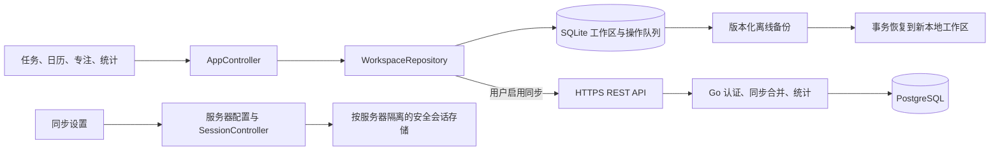

# 本地优先与可选同步架构

更新日期：2026-10-01。首版客户端支持 Android。用户可选择部署服务器进行同步；本地使用不依赖服务器。

## 组件与数据流

## 本地工作区

客户端首次启动时打开 SQLite 工作区，无需账号即可管理任务、排期、计时和查看统计。离线修改写入本地文档及待同步队列。未选择同步账户时，队列只保存在本机，不自动上传。

任务、项目、计划、专注状态及本机设置在写入成功后更新界面。任务排序将涉及的文档及其操作队列写入同一个事务；任意一项失败时全部回滚。任务、项目、计划和应用白名单编辑器在保存失败时保留输入或选择、显示错误并恢复保存按钮。操作队列数量查询在文档提交后执行；该查询失败不撤销已成功的保存，也不将创建操作报告为失败。

数据库同时收到多个打开请求时共用同一次打开操作。打开失败后清除该操作的缓存；初始化页面的“重试”会重新打开数据库，失败不会导致永久复用原有异常。

本地备份包含业务文档、本机设置和未同步修改，不包含密码、会话令牌、服务器配置或旧同步游标。恢复时，客户端先验证格式版本、字段和实体引用，再在单一数据库事务中创建新工作区。原工作区保持不变；恢复失败时不会留下部分恢复数据。

跨服务器复制时，客户端为目标服务器重新生成同步操作，保留实体内容和引用。跨服务器同步不得复用原服务器的游标或已确认的文档版本。

## 可选服务器

客户端支持在运行时配置 HTTPS 服务器地址，并对地址进行规范化。凭据、设备登记、工作区和同步状态应按服务器和账户隔离。不同服务器返回相同用户 ID 时，仍使用独立的工作区。

连接新服务器时，客户端默认打开独立的云端工作区。只有用户明确选择后，才上传现有本地数据。切换服务器前须停止原服务器的同步任务；原服务器的响应不得写入新工作区，原令牌不得发送给新服务器。

会话过期、设备撤销、退出账号或网络请求失败时，客户端暂停同步，本地编辑、专注和导出仍可用。删除服务器账户与删除本地副本是独立操作，界面分别说明其影响。

## 同步与领域约束

同步使用现有 `/v1` 业务 API、UUID、批量 push、分页 pull、游标和删除墓碑。服务端检查字段级版本合并、重复操作、活动专注和冲突。WebSocket API 仅发送变更提示，客户端通过 REST 增量拉取同步数据并保持一致性。

任务截止时间、计划时段和实际专注记录分别存储。守护模式在本机使用的应用包名、应用目录、权限和白名单不上传。服务器接收符合实体契约的专注汇总和脱敏中断分类。

### 专注会话与本机服务

客户端仅控制本机发起的活跃专注。新会话的控制标记按工作区保存在本机全局设置中，不进入同步正文或可移植备份。连接同步账户时，也可通过当前登记设备与 `started_device_id` 的匹配确认控制权限，并保存本机标记。旧版 `android-local` 会话仅在原始 `__local__` 工作区中兼容恢复；备份恢复或本地复制不继承该权限。

其他设备的活跃专注显示在历史中，不会启动本机服务，也不能通过本机暂停、恢复或结束。同步工作区只要已知存在活跃会话就不允许新建，以遵守服务端每账户最多一个活跃专注的约束。两台尚未交换最新数据的离线设备仍可能分别开始专注；后续同步按服务端现有活动会话与时间重叠检查处理。本地副本中的外部活动记录保持只读，不阻止副本开始新的本机专注。

初始化或打开工作区时，客户端向 Android 前台服务提交本机活跃会话的 ID、剩余时间、暂停状态、本机白名单和已保存的守护计数。服务恢复相同 ID 时保留已有计数与提交计数中的较大值；切换到不同 ID 时使用该会话提交的计数。暂停会话恢复为暂停通知，不开启守护监测。当前工作区没有本机活跃会话而原生状态仍为活动时，客户端提交停止请求，清理已经结束会话遗留的本机服务。专注控制及守护统计刷新串行执行，避免并发创建或晚到的统计写入重新激活已结束会话。

原生监测结果在服务主线程核对监测代次后更新计数，已经停止的监测不会写入后续会话。客户端仅合并原生统计 ID 与当前会话 ID 相同的结果。原生服务请求失败不删除已经持久化的专注记录；系统重启、强制停止后重新打开应用、通知权限及不同 Android 版本的前台服务行为仍需通过真机验收，本地 Flutter 测试不能证明通知和守护实际运行。

现有 PostgreSQL 迁移保持不变；后续数据库结构变化通过新增迁移实现。

## 更新与发行

当前客户端不自动向维护者或同步服务器请求更新信息。用户通过“关于”页打开构建时配置的 `RELEASES_URL`；未配置地址时，页面显示相应说明。服务端保留旧更新 API 以兼容历史客户端，该接口的字段不得限制本地工作区的使用。

正式签名构建与普通贡献者测试分别执行。源码、APK、校验值和签名指纹的对应关系见 [发行流程](RELEASING.md)。服务端部署方法见 [自部署手册](SELF_HOSTING.md)。
