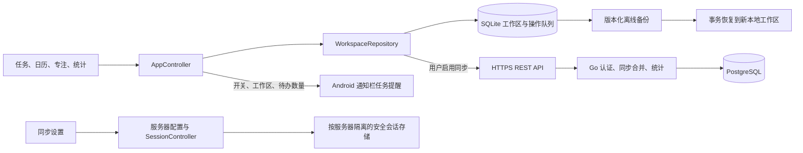

# 本地优先与可选同步架构

更新日期：2026-10-11。首版客户端支持 Android。用户可选择部署服务器进行同步；本地使用不依赖服务器。

## 组件与数据流

## 本地工作区

客户端首次启动时打开 SQLite 工作区，无需账号即可管理任务、排期、计时和查看统计。离线修改写入本地文档及待同步队列。未选择同步账户时，队列只保存在本机，不自动上传。

任务、项目、计划、专注状态及本机设置在写入成功后更新界面。用户手动调整任务顺序时，涉及的文档及其操作队列写入同一个事务；任意一项失败时全部回滚。任务、项目、计划和应用白名单编辑器在保存失败时保留输入或选择、显示错误并恢复保存按钮。操作队列数量查询在文档提交后执行；该查询失败不撤销已成功的保存，也不将创建操作报告为失败。

通用任务列表在读取、创建、编辑及重排后使用 `TaskItem.compareByPriority`：按 `urgent → high → medium → low → none` 排列，同优先级按数值 `rank` 升序、任务 ID 固定顺序排列。筛选和任务选择列表沿用该顺序，排序不改写优先级、截止时间或计划时段。“今日”使用独立读模型，有当天排期的任务按计划开始时间排列，其余任务按 `rank` 排列，保留手动调整。

数据库同时收到多个打开请求时共用同一次打开操作。打开失败后清除该操作的缓存；初始化页面的“重试”会重新打开数据库，失败不会导致永久复用原有异常。

本地备份包含业务文档、本机设置和未同步修改，不包含密码、会话令牌、服务器配置或旧同步游标。恢复时，客户端先验证格式版本、字段和实体引用，再在单一数据库事务中创建新工作区。原工作区保持不变；恢复失败时不会留下部分恢复数据。

跨服务器复制时，客户端为目标服务器重新生成同步操作，保留实体内容和引用。跨服务器同步不得复用原服务器的游标或已确认的文档版本。

## 可选服务器

客户端支持在运行时配置 HTTPS 服务器地址，并对地址进行规范化。凭据、设备登记、工作区和同步状态应按服务器和账户隔离。不同服务器返回相同用户 ID 时，仍使用独立的工作区。

连接新服务器时，客户端默认打开独立的云端工作区。只有用户明确选择后，才上传现有本地数据。切换服务器前须停止原服务器的同步任务；原服务器的响应不得写入新工作区，原令牌不得发送给新服务器。

会话过期、设备撤销、退出账号或网络请求失败时，客户端暂停同步，本地编辑、专注和导出仍可用。删除服务器账户与删除本地副本是独立操作，界面分别说明其影响。

## 同步与领域约束

同步使用现有 `/v1` 业务 API、UUID、批量 push、分页 pull、游标和删除墓碑。服务端检查字段级版本合并、重复操作、活动专注和冲突。WebSocket API 仅发送变更提示，客户端通过 REST 增量拉取同步数据并保持一致性。

任务截止时间、计划时段和实际专注记录分别存储。守护模式在本机使用的应用包名、应用目录、权限和白名单不上传。服务器接收符合实体契约的专注汇总和脱敏中断分类。

### 专注会话与本机服务

客户端仅控制本机发起的活跃专注。新会话的控制标记按工作区保存在本机全局设置中，不进入同步正文或可移植备份。连接同步账户时，也可通过当前登记设备与 `started_device_id` 的匹配确认控制权限，并保存本机标记。旧版 `android-local` 会话仅在原始 `__local__` 工作区中兼容恢复；备份恢复或本地复制不继承该权限。

其他设备的活跃专注显示在历史中，不会启动本机服务，也不能通过本机暂停、恢复或结束。同步工作区只要已知存在活跃会话就不允许新建，以遵守服务端每账户最多一个活跃专注的约束。两台尚未交换最新数据的离线设备仍可能分别开始专注；后续同步按服务端现有活动会话与时间重叠检查处理。本地副本中的外部活动记录保持只读，不阻止副本开始新的本机专注。

初始化或打开工作区时，客户端向 Android 前台服务提交本机活跃会话的 ID、剩余时间、暂停状态、本机白名单和已保存的守护计数。服务恢复相同 ID 时保留已有计数与提交计数中的较大值；切换到不同 ID 时使用该会话提交的计数。暂停会话恢复为暂停通知，不开启守护监测。当前工作区没有本机活跃会话而原生状态仍为活动时，客户端提交停止请求，清理已经结束会话遗留的本机服务。专注控制及守护统计刷新串行执行，避免并发创建或晚到的统计写入重新激活已结束会话。

原生监测结果在服务主线程核对监测代次后更新计数，已经停止的监测不会写入后续会话。客户端仅合并原生统计 ID 与当前会话 ID 相同的结果。原生服务请求失败不删除已经持久化的专注记录；系统重启、强制停止后重新打开应用、通知权限及不同 Android 版本的前台服务行为仍需通过真机验收，本地 Flutter 测试不能证明通知和守护实际运行。

### 通知栏任务提醒

Android 客户端通过 `pactick/task_reminders` 平台通道提交提醒开关、当前工作区标识和状态为 `open` 的任务数量。`AppController` 在初始化、任务数量、开关或工作区变化及回到前台时更新；更新串行执行，旧请求的返回结果不覆盖新状态。初始化或工作区切换失败时取消原数量快照的展示，平台错误由设置页提供重试，不改变本地任务写入结果。

`TaskReminderManager` 将开关、工作区标识和数量保存在 Android 私有设置中，使用独立的 `task_reminders` 通知分类和固定通知 ID 显示一条持续静默提醒，不保存任务正文。完成全部任务、关闭提醒或系统不允许通知时移除；切换工作区先取消旧通知再按新数量展示。提醒不启动闹钟、后台轮询或专注前台服务。`TaskReminderReceiver` 在设备重启或应用更新时从快照恢复；应用关闭期间的服务器变化不会单独拉取，数量需通过原有本机读取和同步更新。

开关 `task_reminders_enabled` 默认开启，保存在本机全局设置，不随同步或备份迁移。需要运行时通知权限且此前未申请过时，首次有待办自动申请一次；拒绝后只由使用者主动申请。任务提醒与专注通知共用系统权限及申请记录。实际允许状态同时检查应用通知权限与提醒分类，不能由开关推断。通知点击由 `MainActivity` 记录请求，Flutter 消费后打开任务页，保留已有表单的退出确认。操作及系统限制见[任务温馨提醒](GETTING_STARTED.md#任务温馨提醒)，实际通知和重启恢复仍需真机验收。

提醒使用通知 ID `1301`，点击后不自动移除。该通知不创建、读取触发时间或更新同步 `reminder` 实体，不具备按截止时间或日历时段调度的能力。真实设备检查按[排序与任务提醒清单](ANDROID_TASK_REMINDER_CHECKLIST.md)记录。

### 本机私密存储与服务器管理

`PrivateVaultController` 通过独立密文存储接口读写工作区私密箱；解锁后仅向私密界面提供任务、分类、计划和专注。普通任务读取及同步文档不包含这些记录。`AppController` 协调普通和私密专注互斥，Android 原生计时只接收私密专注的通用标题，后台与工作区切换清除内存解密内容。工作区备份版本 2 携带密文，不携带本机计时控制权，详见[私密任务箱](PRIVATE_TASK_VAULT.md)。

独立 Go 管理程序提供本机浏览器界面、进程操作、备份、隔离恢复检查及管理员建号。管理授权不使用普通同步令牌；公开注册关闭时仍可建号。四个目标平台及外部依赖限制见[服务器管理](SERVER_MANAGEMENT.md)。

现有 PostgreSQL 迁移保持不变；后续数据库结构变化通过新增迁移实现。

## 更新与发行

当前客户端不自动向维护者或同步服务器请求更新信息。用户通过“关于”页打开构建时配置的 `RELEASES_URL`；未配置地址时，页面显示相应说明。服务端保留旧更新 API 以兼容历史客户端，该接口的字段不得限制本地工作区的使用。

正式签名构建与普通贡献者测试分别执行。源码、APK、校验值和签名指纹的对应关系见 [发行流程](RELEASING.md)。服务端部署方法见 [自部署手册](SELF_HOSTING.md)。
