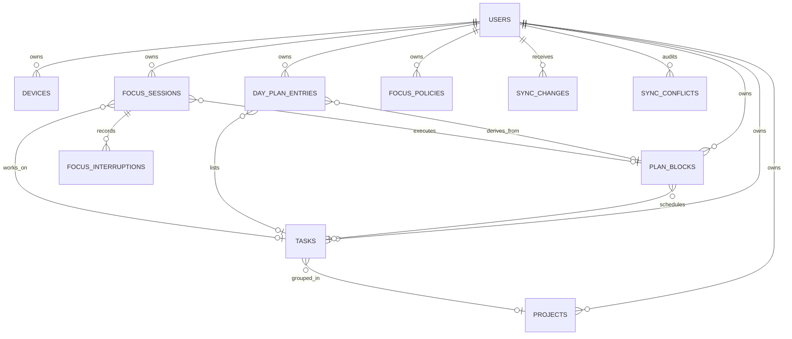

[简体中文](SERVER_ARCHITECTURE.md) | English

# Server architecture

> Design version: 0.2
> Updated: 2026-10-11
> Design basis: tasks, scheduling, Today, focus, and statistics in `PROJECT_PLAN.md`, plus Android guard monitoring, project-specific allowlists, and overlay reminders
> General operations guide: [Self-hosting the server](SELF_HOSTING.en.md)

## 1. Responsibilities and scope

The server manages accounts and devices, stores authoritative cloud copies, and provides multi-device sync, conflict auditing, aggregate queries, and real-time change hints. Clients can still edit tasks, use Today, and time focus while offline.

The first version is a modular monolith deployable as one instance. Modules cooperate through Go interfaces and maintain atomic task, scheduling, and focus constraints in database transactions, without distributed transactions among microservices.

Android guard mode identifies the current app, displays reminders, and maintains Inbox/project-specific allowlists locally. The server stores only cross-device policy parameters, focus results, and sanitized interruption records; it does not perform real-time blocking. Devices continue timing and applying guard rules offline or during brief server outages. Complete app-usage history is not uploaded.

| Capability | Execution location | Server responsibility |
| --- | --- | --- |
| Reliable background timing and ongoing notifications | Android foreground service | Store session starts/ends, pause intervals, and final actual duration |
| Usage Access detection and overlay reminders | Android device | No real-time decisions; receive aggregates only |
| Inbox/project app allowlists | Local device settings | Do not store package names, app names, or allowlist content |
| Task reminders in the notification area | Android device; one ongoing silent notification from the current workspace's `open` count | No push or timed scheduling; the switch and native count snapshot are not uploaded |
| Exit counts and interruption auditing | Client collection, server sync | Store counts and `emergency/allowed/restricted/unknown` classified events |
| Cross-device statistics and calendar review | Server read models | Aggregate planned/actual duration and completed-task counts; interruption facts come through synced entities |
| Strict mode | Separate future validation | Retain the policy enum only; no promise that the server can prevent opening device apps |

### 1.1 Mapping product functions to server contracts

| Product function | Write model | Read API / sync result | Constraint |
| --- | --- | --- | --- |
| Inbox, projects, tags, completed tasks | `project`, `task`, `tag`, `task_tag` | `sync/push`, `sync/pull` | Deadlines are distinct from planned times |
| Today ordering, manual additions, deferral | `day_entry` | `GET /v1/views/today` | Unmaterialized plans for the day are derived stably by the read model |
| Day/week/month scheduling and adjustment | `plan_block` | `GET /v1/views/calendar` | Plans and actual focus use separate tables |
| Normal/guard focus and exit review | `focus_policy`, `focus_session`, `focus_interruption` | Calendar returns sessions; sync returns sanitized interruptions | Timing, app decisions, and reminders remain device-local |
| Scheduled-reminder entity contract | `reminder` | Incremental sync | `delivery_mode=local`; clients separately schedule inexact alarms from local deadlines/plan starts; the server does not provide on-time push |
| 7/28-day planned-versus-actual statistics | The task, plan, and session entities above | `GET /v1/stats/summary` | IANA-zone aggregation; only terminal focus contributes actual duration |
| Profile, devices, export, deletion | `users`, `devices`, refresh tokens | `/v1/me`, `/v1/devices`, `/v1/account/*` | Device revocation also invalidates its refresh tokens |

```text
Flutter / Kotlin client
  ├─ SQLite authoritative working copy and pending-sync operations
  ├─ Reliable local timing, UsageStats observation, overlay reminders
  ├─ Local project allowlists, installed-app directory, permissions (never uploaded)
  └─ Sanitized session aggregates and interruption events
          │
          ├─ HTTPS: authentication, batch push, incremental pull, aggregate queries
          └─ WebSocket: new-cursor hints only, no authoritative data
                          │
Go modular monolith
  ├─ auth: accounts, devices, access tokens, refresh tokens
  ├─ sync: domain validation, version merging, tombstones, conflict audit
  ├─ views: Today, Calendar, planned/actual statistics
  └─ realtime: cursor notifications
                          │
                      PostgreSQL
```

The server provides WebSocket cursor notifications so connected clients can pull changes sooner. The current Flutter client uses incremental REST sync and periodic pulling and has not connected WebSocket yet. Future integration must still retrieve data through the existing incremental protocol; a notification is neither a business document nor proof of completed sync.

## 2. Domain and storage

Planned and actual times are stored separately in `plan_blocks` and `focus_sessions`. Deadlines exist only as `due_at` in task documents. Today uses `day_plan_entries` rather than reusing task or calendar records.

Principal relationships:



Synced entity tables share a server envelope:

- `id`: client-generated UUID;
- `user_id`: owning account;
- `body`: domain document validated against server field allowlists and types;
- `version`: monotonically increasing entity version;
- `field_versions`: entity version at the last change to each top-level field;
- `deleted_at`: soft-deletion tombstone;
- `created_by_device_id`, `updated_by_device_id`: device auditing;
- `last_change_seq`: last server sync cursor.

See the [sync entity field contracts](ENTITY_SCHEMAS.en.md) for required `body` fields, enums, and cross-field constraints.

`body` uses JSONB to support field-wise evolution in offline sync. Common filter fields have expression indexes. Write transactions verify that referenced entities belong to the current account. Users, devices, refresh tokens, and sync ledgers use ordinary relational columns.

## 3. Sync protocol

Clients generate a UUID `operation_id` for every local change and upload the entity type, UUID, operation, last-seen `base_version`, changed top-level fields, and patch. A request accepts at most 200 operations. The server commits them individually in request order; a failed item does not undo other items already committed in the same request.

Processing order:

1. Validate the access token and device state.
2. Begin a write transaction and obtain a shared sync-migration lock and account-level transaction lock.
3. Validate device state, look up `operation_id` in the idempotency ledger, and lock the existing entity row.
4. Merge the patch and perform complete domain and same-account reference validation.
5. Allocate a globally increasing cursor and write the entity, change ledger, and necessary conflict logs.
6. Save the idempotent result and commit.
7. Publish a WebSocket cursor hint.

Pull treats `cursor` as an exclusive lower bound and returns snapshot changes paginated in ascending cursor order. Clients must save the response's `next_cursor` and continue immediately while `has_more=true`. Initial sync starts at cursor 0 and uses the same paginated pull protocol.

Sync write transactions for one account execute in account-lock acquisition order; the lock lasts until commit or rollback. Cursors are allocated after locking, so a larger cursor in the same account cannot become visible to pulls before a smaller uncommitted cursor. Different accounts can still write concurrently. Rollback may leave cursor gaps; clients must not require contiguous cursors. New sync-log write paths must call `database.LockSyncWrites` before reading entities or allocating cursors.

### 3.1 Conflict rules

- Different fields merge automatically using `field_versions`.
- For the same field, server receipt order determines last-write-wins; both values and conflicting fields are recorded in `sync_conflicts`.
- Deletion wins over stale edits; a stale edit cannot resurrect a tombstone.
- Duplicate operations return the originally saved result without another change.
- Database unique indexes prevent different UUIDs representing the same tag association, plan/date entry, or recurring task instance.
- Active focus has a partial unique index, and all new focus sessions are checked for interval overlap. When two offline devices focus concurrently, the later-synced session returns `focus_session_overlap`; clients prompt the user to select a resolution.

Client times are for auditing only and must not determine conflict outcomes, so device-clock changes do not undermine deterministic merging.

## 4. Today, recurrence, and reminders

The Today read model calculates a local day's UTC start/end in the requested IANA zone, supporting 23/25-hour daylight-saving days. It merges:

- Synced `day_plan_entries`;
- `plan_blocks` scheduled for the day but not yet materialized as Today entries.

The latter use stable derived UUIDs from the user, date, and plan block. Reordering, deferring, or modifying a derived entry creates a formal Today entry. Plans enter Today automatically without a midnight scheduled job.

Simple recurrence uses a rule, source-task UUID, and `occurrence_date`. Clients may generate instances offline in advance. A database unique index rejects same-day duplicate instances submitted by multiple devices. Clients should use identical UUIDv5 inputs so the same instance receives the same ID everywhere and repeated uploads are entity-idempotent.

The server stores reminder definitions as synced `reminder` entities; `delivery_mode` is currently fixed to `local`. When future clients integrate timed reminders, they should schedule from the local database. The cloud syncs definitions and status only; downloaded reminders should not require cloud connectivity. The current Android client has not yet provided deadline/plan-based scheduling entry points.

The current Android [task reminder](GETTING_STARTED.en.md) only displays an ongoing silent notification from the local workspace's open-task count. It does not create/fire `reminder`, initiate server push, or add sync. Changes from other devices update the count after normal local sync reads them.

## 5. Focus state and privacy

Allowed focus transitions:

```text
running ──> paused ──> running
   │           │
   └───────────┴──> completed | abandoned | interrupted
```

Terminal records cannot be overwritten; only interruption records may be appended or another focus session created. Terminal states require an end time and actual duration. Paused states require a pause-start time and a final open `pause_intervals` entry matching `pause_started_at`. The server does not count down once per second; it receives and validates timestamps, accumulated pauses, and actual durations.

### 5.1 Guard-mode data classification

Guard data is handled in three categories:

| Data layer | Examples | Handling |
| --- | --- | --- |
| Private device data | Installed apps, package names, labels, foreground-app timeline, Usage Access/overlay authorization, project allowlists | Remains only on the originating device; excluded from sync queues, logs, account export, and backups |
| Syncable sanitized facts | `app_exit_count`, `interruption_count`, interruption type/category, start/end times, duration | Synced through `focus_session` and append-only `focus_interruption`; no app identifiers |
| Server-derived results | Daily/weekly actual focus, planned/actual differences, completed-task counts | Computed from synced entities without inferring specific apps used |

`focus_policy` syncs only device-independent behavior, including mode, pause permission, early-exit rules, maximum exits, emergency categories, and notification mode. In contract 0.2, `allowed_app_ids` remains only for compatibility and may be omitted, `null`, or empty; nonempty values are rejected. Migration `000002_remove_synced_app_identifiers` clears the field in old databases, increments entity versions, and writes normal sync changes to publish new snapshots without app identifiers. New Inbox/project allowlists use a local `project_id -> package set` mapping and must not upload to the server.

`focus_interruptions` accepts exit types and `emergency/allowed/restricted/unknown` classifications only, not package names, app names, foreground-app fields, or usage history. `permission_disabled` records guard permissions becoming unavailable during a session, indicating degraded guarding without installed-app information.

### 5.2 Guard-session data flow

1. The client gets `project_id` from the local task, reads the device allowlist, and starts the Android foreground service. The server does not decide whether to start.
2. Android uses reliable time for timing, observes exits through UsageStats, and displays return reminders when overlay permission is available.
3. The client saves the session in SQLite, continues offline, and uploads through ordinary sync after connectivity returns.
4. Session updates contain only accumulated exits, interruption counts, pause intervals, and state. Specific apps are classified locally and then discarded immediately or retained only within local diagnostics.
5. Auditable interruptions create immutable `focus_interruption` records after ending. The client determines whether repeated exits make the session `interrupted` using the rules selected at startup.
6. The server validates references, transitions, device identity, time ranges, and account-level active-session exclusion, then includes results in calendar/statistics read models.

### 5.3 Server invariants

- `started_device_id` must be a registered device of the current account and, on creation, match the submitting device.
- Only the originating device may update or delete an existing session. Others receive `focus_device_mismatch`; history reads are unaffected.
- Each account has at most one `running/paused` session, and new sessions cannot overlap existing session intervals.
- `started_at` and `started_device_id` are immutable after creation; terminal sessions are entirely immutable.
- `focus_interruption` is append-only and immutable. Domain validation rejects app-identity fields.
- Client wall-clock time does not determine conflict outcomes. The server does not remotely control or lock devices.
- Strict mode may be labeled effective only after client platform-capability and store-policy validation. `mode=strict` on the server does not establish that a device is actually locked.

## 6. Security design

- Passwords use Argon2id with random salts.
- Access tokens default to 15 minutes.
- Refresh tokens are high-entropy opaque values; only SHA-256 digests are stored.
- Every refresh rotates tokens. Reuse of an old token revokes its entire token family.
- Users may view and revoke any registered device; revocation invalidates all its refresh tokens.
- All business queries include `user_id`; references also verify same-account ownership.
- JSON requests are limited to 2 MiB and batches to 200 operations.
- CORS allows no browser origins by default; origins require explicit configuration.
- Account export reads profiles, devices, and 11 entity types in one read-only `REPEATABLE READ` transaction, including soft-deletion state but excluding passwords, tokens, and token digests. Creates, updates, and deletions committed after the export begins reading do not enter its snapshot. Transaction/query failure does not return partial export. Account deletion requires the current password and a fixed confirmation phrase and cascades through account data in one database operation.
- Production must enforce TLS behind a trusted reverse proxy or load balancer and inject JWT secrets and database credentials from secret management.

Before public testing, gateway controls should add login limits by IP/account, general request quotas, audit-log redaction, and a key-rotation procedure.

## 7. Deployment and recovery

`compose.yaml` is for local development only. Before 1.0, the deployment plan uses one host and local backups, with these minimum requirements:

- One API instance with PostgreSQL on the same host.
- Daily custom-format logical backups and an additional backup before migrations.
- Local retention of 7 daily, 4 weekly, 6 monthly, and 10 pre-migration versions, verified with SHA-256 and `pg_restore --list`.
- Regular local-backup restore checks in an isolated container with a separate volume.
- Alerts for `readyz`, 5xx, login failures, sync rejection rate, database capacity, local disk, and backups.
- Logs must not contain passwords, access/refresh tokens, or full request bodies.

Local backups do not provide host-level disaster recovery. Losing the server, system disk, or same-host backup directory leaves no usable copy, so no RPO/RTO can currently be promised. Before 1.0, add encrypted off-site backups, independent-account or regional storage, off-site backup alerts, and drills restoring an off-site copy to a new host. Evaluate managed PostgreSQL, automatic snapshots, and PITR according to scale.

Migrations run sequentially under a PostgreSQL advisory lock. Each file has its own transaction, and recorded SHA-256 detects changes to applied files. Each migration transaction first takes an exclusive sync-migration lock, waits for current sync writes, and blocks new writes, including SQL producing sync logs in older migrations. This depends on APIs using the current write-lock implementation. Stop old APIs before upgrading; they cannot run concurrently with migrations.

The current realtime hub is in-process, appropriate for the first single-API deployment. Multi-instance scaling should replace publishing with PostgreSQL `LISTEN/NOTIFY` or a message broker without changing REST cursor sync. PostgreSQL transaction advisory locks release automatically on transaction completion and can serialize application-resource access. `CREATE TABLE ... LIKE ... INCLUDING ALL` copies indexes, primary keys, and other definitions. See [PostgreSQL advisory locks](https://www.postgresql.org/docs/current/functions-admin.html) and [CREATE TABLE](https://www.postgresql.org/docs/current/sql-createtable.html).

Deployers supply a domain and server. Production Compose uses two bridges: internal `backend` connects API, migration containers, and PostgreSQL only; ordinary `ingress` connects only the API and supplies the gateway for Docker host-port publishing. The API binds to host loopback only (default `127.0.0.1:8080`); PostgreSQL publishes no port. Public REST and WSS go through an HTTPS reverse proxy. See the [self-hosting guide](SELF_HOSTING.en.md) for installation, account creation, upgrades, backups, and acceptance commands.

## 8. Component scope and limitations

The private task vault uses separate client ciphertext storage, outside ordinary business sync APIs. It sends no private tasks or their dedicated plans/focus to the server. Server administrators can create accounts through the separate local manager or administrator command without enabling public registration. This creates a user only and issues no device or login token. See [server management](SERVER_MANAGEMENT.en.md) for implementation and operating limits.

- Bidirectional external-calendar sync;
- Team spaces, sharing permissions, and collaboration;
- Server storage of detailed app-usage history;
- Cross-device sync of app allowlists, package names, or permission state;
- System-wide app blocking on Windows/Linux;
- Realtime broadcasting among multiple API instances;
- Push channels and cloud reminder executors;
- End-to-end encryption and complete version history.

The first server's task, scheduling, Today, focus, and statistics flows do not depend on the capabilities listed above.
