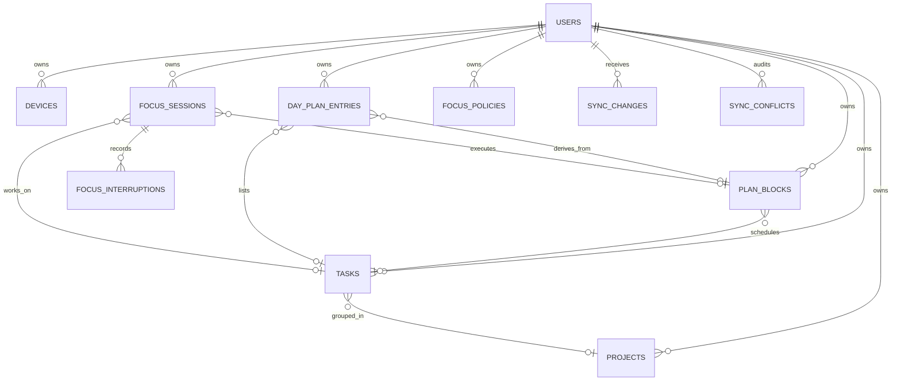

# 服务端架构说明

> 设计版本：0.2  
> 更新日期：2026-09-12  
> 设计依据：`PROJECT_PLAN.md` 中的任务、排期、今日清单、专注与统计流程，以及 Android 客户端的守护监测、按项目白名单和悬浮提醒设计  
> 通用操作手册：[自部署服务端](SELF_HOSTING.md)

## 1. 职责与范围

服务端管理账户和设备，保存云端权威副本，并提供多设备同步、冲突审计、聚合查询和实时变更提示。客户端在离线时仍可编辑任务、使用今日清单和进行专注计时。

第一版采用可单实例部署的模块化单体。模块通过 Go 接口协作，在数据库事务内维护任务、排期和专注的原子约束，无需引入微服务之间的分布式事务。

守护模式由 Android 在本机判断当前应用、展示提醒，并维护按收集箱或项目划分的白名单。服务端只保存跨设备需要的策略参数、专注结果和脱敏中断记录，不参与实时拦截。离线或服务器短暂不可用时，设备仍可计时和执行守护规则；完整应用使用历史不上传到云端。

| 能力 | 执行位置 | 服务端职责 |
| --- | --- | --- |
| 后台可靠计时与常驻通知 | Android 前台服务 | 保存会话起止、暂停区间和最终实际时长 |
| Usage Access 检测与悬浮提醒 | Android 本机 | 不参与实时判断；只接收汇总结果 |
| 按收集箱/项目配置应用白名单 | 设备本地设置 | 不保存包名、应用名称或白名单内容 |
| 离开次数与中断审计 | 客户端采集，服务端同步 | 保存计数和 `emergency/allowed/restricted/unknown` 分类事件 |
| 多端统计与日历复盘 | 服务端读模型 | 聚合计划时长、实际时长和完成任务数；中断事实通过同步实体获取 |
| 严格模式 | 后续单独验证 | 只保留策略枚举，不承诺服务端能阻止设备打开应用 |

### 1.1 功能到服务端契约的映射

| 产品功能 | 写模型 | 读接口/同步结果 | 约束 |
| --- | --- | --- | --- |
| 收集箱、项目、标签、完成任务 | `project`、`task`、`tag`、`task_tag` | `sync/push`、`sync/pull` | 截止时间不等于计划时间 |
| 今日排序、手动加入、延期 | `day_entry` | `GET /v1/views/today` | 未物化的当日计划由读模型稳定派生 |
| 日/周/月排期与调整 | `plan_block` | `GET /v1/views/calendar` | 计划时段与实际专注分表保存 |
| 普通/守护专注与退出复盘 | `focus_policy`、`focus_session`、`focus_interruption` | 日历返回会话；同步返回脱敏中断 | 实时计时、应用判断与提醒均在设备本地 |
| 任务与计划提醒 | `reminder` | 增量同步 | `delivery_mode=local`，服务器不负责准点推送 |
| 7/28 天计划—实际统计 | 上述任务、计划与会话实体 | `GET /v1/stats/summary` | 按 IANA 时区聚合，终态专注才计入实际时长 |
| 资料、设备、导出与删除 | `users`、`devices`、刷新令牌 | `/v1/me`、`/v1/devices`、`/v1/account/*` | 设备撤销同时废止其刷新令牌 |

```text
Flutter / Kotlin 客户端
  ├─ SQLite 权威工作副本与待同步操作队列
  ├─ 本地可靠计时、UsageStats 观察与悬浮提醒
  ├─ 本地按项目白名单、已安装应用目录和权限状态（永不上传）
  └─ 脱敏后的会话汇总与中断事件
          │
          ├─ HTTPS：认证、批量推送、增量拉取、聚合查询
          └─ WebSocket：仅通知“有新游标”，不传权威数据
                          │
Go 模块化单体
  ├─ auth：账户、设备、访问令牌、刷新令牌
  ├─ sync：领域校验、版本合并、墓碑、冲突审计
  ├─ views：今日、日历、计划/实际统计
  └─ realtime：游标通知
                          │
                      PostgreSQL
```

WebSocket 用于提示客户端尽早拉取变更。客户端收到通知后调用增量拉取；WebSocket 连接不可用时改用定时拉取。两种方式使用相同的同步协议，网络切换不改变一致性语义。

## 2. 领域与存储

计划时间和实际时间分别保存在 `plan_blocks` 与 `focus_sessions`，截止时间只存在任务文档的 `due_at`。今日条目使用 `day_plan_entries`，不复用任务或日历记录。

主要关系如下：



同步实体表使用统一的服务端信封：

- `id`：客户端生成的 UUID；
- `user_id`：实体所属账户；
- `body`：经过服务端白名单和类型校验的领域文档；
- `version`：实体级递增版本；
- `field_versions`：每个顶层字段最后修改时的实体版本；
- `deleted_at`：软删除墓碑；
- `created_by_device_id`、`updated_by_device_id`：设备审计；
- `last_change_seq`：最后一次服务端同步游标。

各实体 `body` 的必填字段、枚举和交叉约束见 [同步实体字段契约](ENTITY_SCHEMAS.md)。

`body` 使用 JSONB，支持离线同步协议按字段演进。常用筛选字段建立表达式索引；写入事务校验引用的实体是否属于当前账户。用户、设备、刷新令牌和同步账本使用普通关系列。

## 3. 同步协议

客户端为每次本地修改生成一个 UUID `operation_id`，并上传：实体类型、实体 UUID、操作、客户端看到的 `base_version`、实际修改的顶层字段和 patch。一次请求最多 200 个操作，服务端按请求顺序逐个提交；单项失败不会撤销同一请求中已经提交成功的其他操作。

处理顺序为：

1. 验证访问令牌与设备状态；
2. 开始写事务，取得同步迁移共享锁和账户级事务锁；
3. 验证设备状态，使用 `operation_id` 查询幂等账本，并锁定现有实体行；
4. 合并 patch，执行完整领域校验与账户内引用校验；
5. 分配全局递增游标，写实体、变更账本和必要的冲突日志；
6. 记录幂等结果并提交；
7. 发布 WebSocket 游标提示。

拉取接口以 `cursor` 为开区间起点，按游标升序分页返回快照式变更。客户端必须保存响应的 `next_cursor`；`has_more=true` 时立即继续拉取。初始化同步从游标 0 开始分页，使用同一拉取协议。

同一账户的同步写事务按取得账户锁的顺序执行，账户锁持续到提交或回滚。游标在取得锁后分配，因此同一账户较大的游标不会先于较小的未提交游标对拉取请求可见。不同账户仍可并发写入；回滚可能产生游标空号，客户端不得要求游标连续。新增同步日志写入路径必须在读取实体和分配游标之前调用 `database.LockSyncWrites`。

### 3.1 冲突规则

- 不同字段：按 `field_versions` 自动合并；
- 同一字段：以服务端接收顺序决定后到写入覆盖先到写入，同时将双方值和冲突字段写入 `sync_conflicts`；
- 删除与过期编辑：删除优先，过期编辑不能复活墓碑；
- 重复操作：返回首次保存的结果，不重复产生变更；
- 标签关联、计划日期条目、重复任务实例：数据库唯一索引阻止不同 UUID 表示同一关系；
- 专注：活动状态有部分唯一索引；所有新专注还会检查时间区间重叠。两台离线设备同时专注时，后同步的会话返回 `focus_session_overlap`，客户端提示用户选择冲突处理方式。

客户端时间仅用于审计，不得用于决定冲突处理结果，以免设备时钟变更影响合并的确定性。

## 4. 今日、重复任务与提醒

“今日”读模型按请求指定的 IANA 时区计算本地日的 UTC 起止，支持夏令时的 23/25 小时日期。返回内容由两部分合并：

- 已同步的 `day_plan_entries`；
- 当天有计划、但尚未物化为今日条目的 `plan_blocks`。

后者使用用户、日期和计划时段生成稳定的派生 UUID。用户排序、延期或修改派生条目时，客户端创建正式今日条目。计划自动进入今日清单不依赖午夜定时任务。

简单重复任务由规则、来源任务 UUID 和 `occurrence_date` 表示。客户端可离线预生成实例，数据库唯一索引拒绝多设备提交的同日重复实例。推荐客户端使用相同的 UUIDv5 输入，使同一实例在各设备上获得相同 ID，重复上传也具有实体级幂等性。

提醒定义作为 `reminder` 同步实体保存，第一版 `delivery_mode` 为 `local`。各客户端依据本地数据库调度通知，云端同步提醒定义和状态。已经下载的提醒不依赖云端在线。

## 5. 专注状态与数据隐私

允许的专注状态转换：

```text
running ──> paused ──> running
   │           │
   └───────────┴──> completed | abandoned | interrupted
```

终态记录不可再次覆盖，只能追加中断记录或新建下一次专注。终态必须有结束时间和实际时长；暂停态必须有暂停开始时间，并在 `pause_intervals` 最后保留一个与 `pause_started_at` 相同的开放区间。服务端不根据“每秒减一”计时，只接收和校验时间戳、暂停累计与实际时长。

### 5.1 守护模式的数据分类

守护模式按以下三类处理数据：

| 数据层 | 示例 | 处理规则 |
| --- | --- | --- |
| 设备私密数据 | 已安装应用、包名、应用标签、前台应用时间线、Usage Access/悬浮层授权状态、按项目白名单 | 只保存在产生它的设备上，不进入同步队列、日志、账户导出或备份 |
| 可同步脱敏事实 | `app_exit_count`、`interruption_count`、中断类型、类别、起止时间和时长 | 通过 `focus_session` 和追加型 `focus_interruption` 同步；不得携带应用标识 |
| 服务端派生结果 | 每日/每周实际专注时长、计划与实际差异、完成任务数 | 从同步实体计算，不回推具体使用了哪个应用 |

`focus_policy` 只同步与设备无关的行为参数，例如模式、是否允许暂停、提前退出规则、最大离开次数、紧急应用类别和通知方式。`allowed_app_ids` 在 0.2 契约中仅作为兼容字段保留，只允许省略、`null` 或空数组；非空值会被服务端拒绝。`000002_remove_synced_app_identifiers` 迁移会清除旧数据库中的该字段，递增实体版本，并写入正常的同步变更，向已连接客户端发布不含应用标识的新快照。客户端新增的按收集箱/项目白名单使用本地 `project_id -> package set` 映射，不能上传到服务器。

`focus_interruptions` 只接受离开类型和 `emergency/allowed/restricted/unknown` 分类，不接受具体应用包名、应用名称、前台应用或使用历史字段。`permission_disabled` 记录守护所需权限在会话中失效，表示守护能力已降级，不包含设备安装内容。

### 5.2 守护会话的数据流

1. 客户端从本地任务得到 `project_id`，读取本机白名单并启动 Android 前台服务；服务端不参与启动判定。
2. Android 使用可靠时间源维护计时，通过 UsageStats 观察离开，并在具备悬浮层权限时显示返回提醒。
3. 客户端把当前会话保存在 SQLite；断网时继续工作，恢复联网后再按普通同步协议上传。
4. 会话更新只携带累计离开数、中断数、暂停区间和状态。具体应用只在本机用于分类，随后立即丢弃或留在本地诊断范围内。
5. 需要审计的中断在结束后创建不可变的 `focus_interruption`。多次离开是否使会话进入 `interrupted` 由客户端依据启动时采用的规则判定。
6. 服务端校验引用、状态转换、设备身份、时间范围和账户级活动会话互斥，再将结果纳入日历与统计读模型。

### 5.3 服务端不变量

- `started_device_id` 必须是当前账户的已登记设备，创建时还必须等于提交操作的设备；
- 已有会话的更新和删除只允许发起设备提交，其他设备返回 `focus_device_mismatch`，读取会话历史不受该限制；
- 同一账户最多一个 `running/paused` 会话，新会话不得与已有会话时间区间重叠；
- `started_at` 与 `started_device_id` 创建后不可修改，终态会话整体不可修改；
- `focus_interruption` 为追加型不可变记录，应用身份字段会在领域校验阶段被拒绝；
- 服务端不依据客户端墙上时钟决定冲突处理结果，也不尝试远程控制或封锁设备；
- 严格模式只有在客户端完成平台能力与商店政策验证后才能标记为有效，服务器上的 `mode=strict` 本身不代表设备确实被锁定。

## 6. 安全设计

- 密码使用 Argon2id 与随机盐；
- 访问令牌默认 15 分钟；
- 刷新令牌是高熵不透明值，数据库只保存 SHA-256 摘要；
- 每次刷新都会轮换令牌，旧令牌再次出现时撤销整个令牌族；
- 用户可以查看并撤销任何已登记设备；撤销会同步废止该设备的全部刷新令牌；
- 所有业务查询都带 `user_id`，引用也验证为同一账户；
- JSON 请求限制为 2 MiB，批量操作限制为 200；
- CORS 默认不放行浏览器来源，必须显式配置；
- 账户导出在同一只读 `REPEATABLE READ` 事务中读取用户资料、设备和 11 类实体，包含软删除状态，排除密码、令牌和令牌摘要；导出开始读取后提交的创建、更新和删除不会混入该快照。事务或任一查询失败时接口不返回部分导出；账户删除要求当前密码与固定确认词，并在单个数据库操作中级联清除账户数据；
- 生产环境必须在受信反向代理或负载均衡器后强制 TLS，并从密钥管理系统注入 JWT 密钥和数据库凭据。

公开测试前还应在网关层添加按 IP 与账户的登录限速、通用请求配额、审计日志脱敏和密钥轮换流程。

## 7. 部署与恢复

`compose.yaml` 只用于本地开发。部署方案规定，1.0 之前采用单机部署和本机备份，最低要求为：

- 一个 API 实例与同机 PostgreSQL；
- 每日创建 custom-format 逻辑备份，数据库迁移前额外备份；
- 本机保留 7 个每日、4 个每周、6 个月度和 10 个迁移前版本，并校验 SHA-256 与 `pg_restore --list`；
- 定期在隔离容器和独立卷验证本机备份可恢复；
- 对 `readyz`、5xx、登录失败率、同步拒绝率、数据库容量、本机磁盘和备份结果告警；
- 日志不得记录密码、访问令牌、刷新令牌或完整请求体。

本机备份不提供主机级容灾。如果整台服务器、系统盘或同机备份目录丢失，将没有可用副本，因此当前无法承诺 RPO/RTO。1.0 上线前必须增加加密异地备份、独立账户或区域存储、异地备份告警、从异地副本恢复到新主机的演练，并根据规模评估托管 PostgreSQL、自动快照和 PITR。

迁移在 PostgreSQL advisory lock 下顺序执行，每个文件单独使用事务，并记录 SHA-256 校验值以检测已应用文件被改写。每个迁移事务先取得同步迁移排他锁，等待当前同步写事务结束，并阻止新的同步写事务进入，包括旧迁移中产生同步日志的 SQL。此约束依赖 API 使用当前写锁实现；升级前必须停止旧版本 API，不能让旧版本与迁移并行运行。

当前实时中心是进程内实现，适用于第一版的单 API 实例部署；扩展到多实例时，应把发布层替换为 PostgreSQL `LISTEN/NOTIFY` 或消息代理，REST 游标协议无需改变。PostgreSQL 的事务级 advisory lock 会随事务结束自动释放，可用于串行化应用资源访问；`CREATE TABLE ... LIKE ... INCLUDING ALL` 会复制索引和主键等定义。[PostgreSQL advisory lock 文档](https://www.postgresql.org/docs/current/functions-admin.html)、[PostgreSQL CREATE TABLE 文档](https://www.postgresql.org/docs/current/sql-createtable.html)

部署者需提供域名和服务器。生产 Compose 使用两个 bridge：`backend` 设置为内部网络，只承载 API、迁移容器和 PostgreSQL；普通 `ingress` 只接入 API，为 Docker 的宿主机端口发布提供网关。API 只绑定宿主机回环地址（默认 `127.0.0.1:8080`），PostgreSQL 不发布端口；公网 REST 与 WSS 由 HTTPS 反向代理转发。安装、建号、升级、备份和验收命令见[自部署手册](SELF_HOSTING.md)。

## 8. 本轮不包含的能力

- 外部日历双向同步；
- 团队空间、共享权限和协作；
- 服务器保存具体应用使用历史；
- 跨设备同步应用白名单、包名或权限状态；
- Windows/Linux 系统级应用封锁；
- 多 API 实例间的实时广播；
- 推送渠道和云端提醒执行器；
- 端到端加密与完整版本历史。

第一版服务端的任务、排期、今日清单、专注和统计流程不依赖上述能力。
